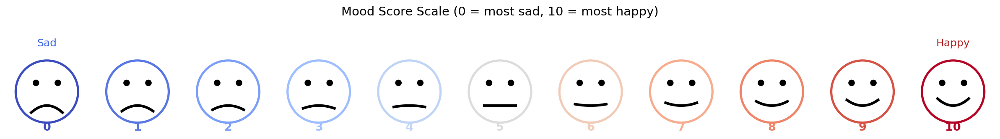
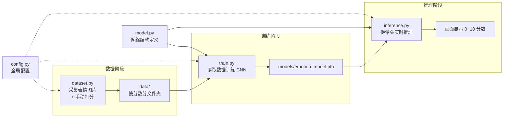
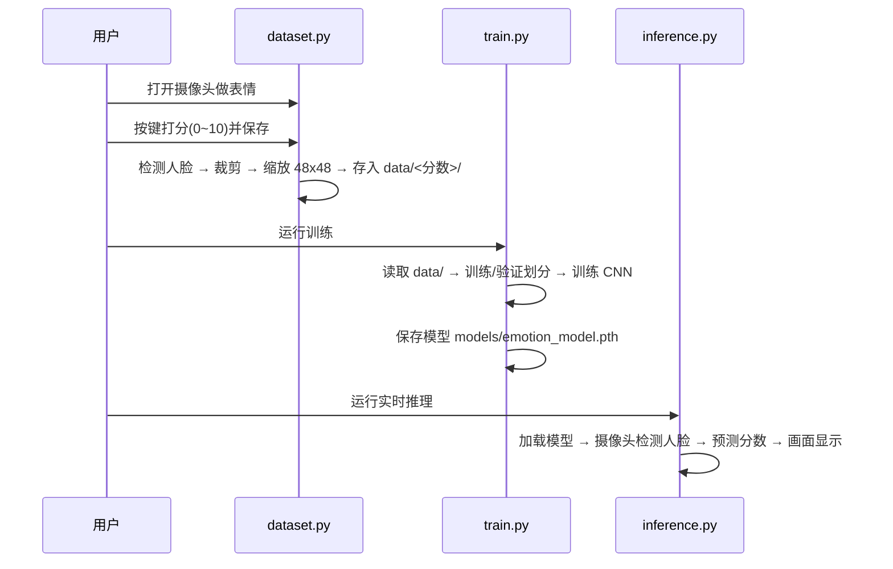
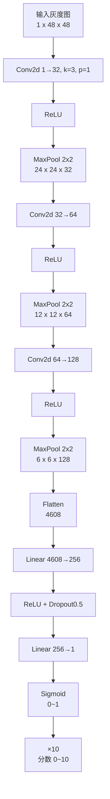
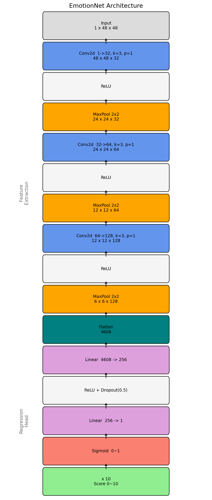
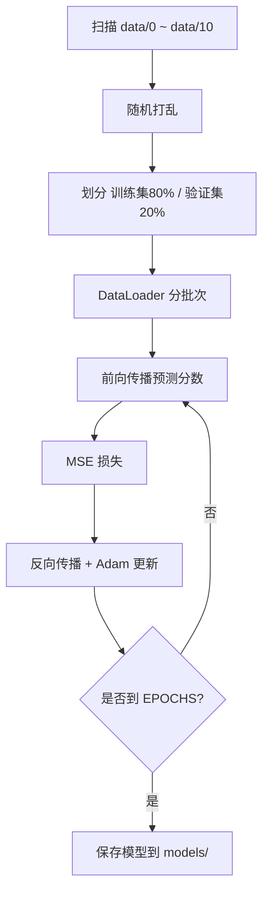

# 人脸表情 → 心情分数（0~10）项目文档

> 本项目使用一个简单的 **CNN（卷积神经网络）** 学习「人脸表情」与「心情分数」之间的对应关系，
> 分数范围 **0 ~ 10**，其中 **0 = 最伤心，10 = 最开心**，中间为连续值。

---

## 目录

1. [项目简介](#1-项目简介)
2. [整体架构](#2-整体架构)
3. [核心模块详解](#3-核心模块详解)
   - 3.1 `config.py` —— 全局配置
   - 3.2 `model.py` —— 网络结构设计
   - 3.3 `dataset.py` —— 数据采集 UI
   - 3.4 `train.py` —— 训练
   - 3.5 `inference.py` —— 实时推理 UI
4. [数据组织与处理流程](#4-数据组织与处理流程)
5. [快速上手](#5-快速上手)
6. [常见问题与调优](#6-常见问题与调优)
7. [附录：文件清单](#7-附录文件清单)

---

## 1. 项目简介

项目要解决的是一个**回归问题**：给定一张人脸灰度图，输出一个 `0~10` 的连续分数，表示心情好坏程度。



- 分数越高 → 表情越开心；分数越低 → 表情越伤心。
- 数据集由用户自己采集：对着摄像头做出不同表情，并手动标注分数。
- 网络使用 CNN 自动提取表情特征，再通过全连接层回归出一个分数。

---

## 2. 整体架构

项目按功能拆分为多个独立 Python 文件，职责清晰：



各模块之间的数据流：



---

## 3. 核心模块详解

### 3.1 `config.py` —— 全局配置

集中管理路径与超参数，其它脚本统一 `import config` 使用。

| 配置项 | 说明 | 默认值 |
| --- | --- | --- |
| `DATA_DIR` | 采集数据的根目录 | `data/` |
| `MODEL_PATH` | 模型保存路径 | `models/emotion_model.pth` |
| `CASCADE_PATH` | 人脸检测级联文件（优先项目内，回退 OpenCV） | 自动解析 |
| `IMG_SIZE` | 输入图像尺寸（灰度，正方形） | `48` |
| `BATCH_SIZE` | 训练批大小 | `16` |
| `EPOCHS` | 训练轮数 | `20` |
| `LEARNING_RATE` | 学习率 | `1e-3` |
| `VAL_RATIO` | 验证集比例 | `0.2` |

> 修改网络输入尺寸或超参数，只需改这一处。

---

### 3.2 `model.py` —— 网络结构设计

核心类 `EmotionNet` 是一个轻量 CNN：**特征提取 + 回归头**。





**设计要点：**

- **特征提取部分**：3 个「卷积 + ReLU + 池化」块，逐步把 48×48 的图压缩成 6×6 的深层特征图，卷积负责提取纹理/边缘/表情特征，池化负责降维。
- **回归头部分**：把特征展平后，用全连接层映射成单个数值。
- **输出约束**：最后一层 `Sigmoid` 把输出压到 `0~1`，再 `×10` 映射到 `0~10`，保证分数始终在合法区间。
- 因为输出是连续分数，这是一个**回归任务**，因此损失函数使用 **MSE（均方误差）**，而不是分类的交叉熵。

---

### 3.3 `dataset.py` —— 数据采集 UI

打开摄像头，实时显示画面，用户通过键盘打分并保存人脸图片。

**按键说明：**

| 按键 | 功能 |
| --- | --- |
| `0` ~ `9` | 设置当前分数为 0~9 |
| `t` | 设置当前分数为 10 |
| `s` | 保存当前检测到的人脸（以当前分数保存） |
| `q` | 退出 |

**处理流程：**


- 保存目录结构：`data/0/`、`data/1/` … `data/10/`。
- 文件名用时间戳，避免重名覆盖。

---

### 3.4 `train.py` —— 训练

读取 `data/` 目录，训练 CNN 并保存模型。

**核心步骤：**

1. **加载数据**：自定义 `EmotionDataset` 遍历 `data/0` ~ `data/10`，把每张图读成灰度图、缩放到 48×48、转成 Tensor，标签就是所在文件夹的分数。
2. **划分数据**：随机打乱后，按 `VAL_RATIO`（默认 20%）切分训练集 / 验证集。
3. **训练循环**：每个 epoch 前向传播 → 计算 MSE 损失 → 反向传播 → Adam 更新参数，并在验证集上计算损失。
4. **保存模型**：`torch.save` 保存到 `models/emotion_model.pth`。



---

### 3.5 `inference.py` —— 实时推理 UI

加载训练好的模型，打开摄像头，实时检测人脸并推演表情分数。

**处理流程：**


- 检测到的人脸上方会实时显示 `Score: x.x`。
- 模型加载使用 `weights_only=True`，避免无关反序列化风险与告警。
- 按 `q` 退出。

---

## 4. 数据组织与处理流程

```
momface/
├── config.py                      # 全局配置
├── model.py                       # CNN 网络结构
├── dataset.py                     # 数据采集 UI
├── train.py                       # 训练脚本
├── inference.py                   # 实时推理 UI
├── requirements.txt               # 依赖列表
├── haarcascade_frontalface_default.xml  # 人脸检测级联文件
├── data/                          # 采集的数据（运行后生成）
│   ├── 0/                         # 分数 0 的人脸图片
│   ├── 1/
│   ├── ...
│   └── 10/
├── models/                        # 训练好的模型（运行后生成）
│   └── emotion_model.pth
└── docs/                          # 本文档与示意图
    ├── 项目文档.md
    ├── generate_images.py
    └── images/
```

**图像统一预处理**（采集、训练、推理三处保持一致）：

1. 转灰度图；
2. 检测人脸并裁剪；
3. 缩放到 `48 × 48`；
4. 转 Tensor 并归一化到 `0~1`。

---

## 5. 快速上手

```bash
# 1. 安装依赖
pip install -r requirements.txt

# 2. 采集数据（每个分数建议各几十张）
python dataset.py

# 3. 训练
python train.py

# 4. 实时推理
python inference.py
```

---

## 6. 常见问题与调优

| 问题 | 说明 / 解决 |
| --- | --- |
| 检测不到人脸 | 调整光照、正对摄像头；或调大 `detectMultiScale` 的 `scaleFactor`、调小 `minNeighbors` |
| 预测分数不准 | 数据太少或分布不均，建议每个分数都采集足够样本；增加 `EPOCHS` |
| 过拟合 | 训练集损失低、验证集损失高：可增大 `VAL_RATIO` 观察，增加数据量，或加强 Dropout |
| 显存不足 | 减小 `BATCH_SIZE` |
| `opencv` 报缺少 `CascadeClassifier` | OpenCV 5.0 移除了旧 API，请固定 `opencv-python<5` |

**提升效果的建议：**

- 每个分数采集的图片数量尽量均衡（例如各 30~50 张）。
- 采集时覆盖不同角度、不同光照，提高泛化能力。
- 可以在 `train.py` 中给训练集加入数据增强（随机水平翻转、亮度抖动等）。

---

## 7. 附录：文件清单

| 文件 | 功能 |
| --- | --- |
| `config.py` | 全局路径与超参数配置 |
| `model.py` | CNN 网络结构定义（`EmotionNet`） |
| `dataset.py` | 数据采集 UI（摄像头 + 键盘打分） |
| `train.py` | 数据加载、训练、保存模型 |
| `inference.py` | 实时推理 UI（摄像头 + 分数显示） |
| `requirements.txt` | 依赖列表 |
| `haarcascade_frontalface_default.xml` | 人脸检测级联分类器 |
| `docs/generate_images.py` | 重新生成本文档示意图的脚本 |
